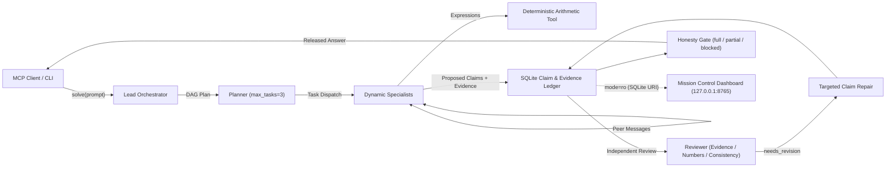

# CrewForge — Submission Package

**Team:** Git Commit  
**Challenge:** Chain of Command — Multi-Agent Systems (SEED Hackathon 2026)  
**Repository:** https://github.com/Sushank37/CrewForge  
**Frozen Core Engine Commit:** `612f64e4c4b55e8ea0b1121ef92e548e1a330d4e`

---

## 1. Project Summary

CrewForge is a model-agnostic, self-assembling multi-agent intelligence network exposed through the **Model Context Protocol (MCP)** (`solve`, `baseline`, `trace`) and paired with **CrewForge Mission Control**, a read-only localhost observability dashboard for inspecting agent topology, claim/evidence lineage, deterministic arithmetic, independent review, and Honesty Gate release decisions.

## 2. Problem Addressed

Multi-agent LLM pipelines often fail silently in two opposite ways: (1) synthesizing unverified or fabricated intermediate claims into confident final prose, or (2) failing opaque structured-output/budget checks without traceable provenance. CrewForge enforces claim-level epistemic accountability so every released assertion is linked to persisted evidence, deterministic arithmetic verification, and independent review—while exposing the full execution and failure trace to operators and judges.

## 3. Architecture



## 4. Technical Novelty

1. **Claim-Locked Honesty Gate:** Final synthesis cannot promote unreviewed, rejected, or stale claims; unresolved items and withholding rationales are surfaced explicitly.
2. **Deterministic Arithmetic Provenance:** AST-evaluated arithmetic binds every variable and literal to verifiable prompt, document, or prior-claim spans.
3. **Unified Canonical Budget Authority:** Atomic SQLite `BEGIN IMMEDIATE` reservations, failed-call usage reconciliation, and explicit `CREWFORGE_ALLOW_PAID_RUNS=false` fail-closed guard.
4. **Strict Event-Order Replay:** `DemoTraceExport` + Mission Control reconstructs topology, task transitions, claim versions, and release decisions strictly by persisted sequence/timestamp without future-state leakage.

## 5. Implemented Capabilities

- Dynamic multi-agent planner, scheduler, peer message bus, targeted claim repair, and Honesty Gate (`src/crewforge/core/`).
- Dedicated unauthenticated public Streamable HTTP MCP service (`crewforge-public-mcp`) exposing async job tools (`run_task`, `get_task_status`, `get_task_result`, `get_task_trace`, `run_single_agent`, `cancel_task`) with production `Dockerfile` ([docs/public_cloud_deployment.md](public_cloud_deployment.md)).
- `FastMCP` local server (`crewforge-mcp`) supporting `stdio` and localhost `streamable-http` (`solve`, `baseline`, `trace`).
- Authenticated browser workspace & Mission Control (`crewforge-dashboard`) with Live Monitor, Historical Replay, and Benchmark views.
- Reproducible blind evaluation harness (`src/crewforge/evaluation/`).

## 6. Installation, MCP Configuration & Mission Control Startup

```bash
git clone https://github.com/Sushank37/CrewForge.git
cd CrewForge
uv sync --python 3.12

# Start Mission Control (reads historical Phase 5E traces + demo_live.db)
uv run crewforge-dashboard --db-path .crewforge/demo_live.db --host 127.0.0.1 --port 8765

# Start MCP Server (in a separate terminal; see docs/JUDGE_QUICKSTART.md for full cloud env)
CREWFORGE_DB_PATH=.crewforge/demo_live.db uv run crewforge-mcp --transport streamable-http --host 127.0.0.1 --port 8000
```

See [docs/JUDGE_QUICKSTART.md](JUDGE_QUICKSTART.md) and [docs/DEMO_RUNBOOK.md](DEMO_RUNBOOK.md) for portable client JSON and walkthrough steps.

## 7. Evaluation Summary

- **Phase 5E Development Canaries (`gpt-6-luna`):** Both `canary_a` (`83.3%` internal req. linkage, `$0.0028538`) and `canary_b` (`80.0%` internal req. linkage, `$0.0038272`) completed with `0` unrecovered truncations and `honesty_gate_passed=True`.
- **V2 Held-Out Same-Model Benchmark (`gpt-6-luna`, 10 internally authored cases, ChatGPT-assisted blind semantic grading):** Single-agent baseline **96.50/100** vs CrewForge **55.50/100** (`1/10` network wins, `1` vs `6` unsupported assertions). CrewForge outperformed on `strategic_planning` (`93.50` vs `87.00`, including `v2_str_02` `100` vs `74`), but underperformed overall due to avoidable withholding of solvable steps and document-grounding contradictions.
- **David vs Goliath (`qwen3:4b` vs `gpt-6.2-astra`):** Not executed — halted at local readiness canary (`qwen3:4b` exceeded `max_tasks=3`).
- **Phase 7 Live MCP Rehearsal (`run_0f816b1133c1`):** Correctly computed `930` / `120` / `$240` (`$0.0030804`), but withheld release (`partial`) due to ungrounded spelled-out/derived durations.

See [docs/EVALUATION.md](EVALUATION.md) for the complete report.

## 8. Known Limitations & Future Improvements

- **Limitations:** Strict verbatim provenance rejects spelled-out numbers (`"five hours"`) and derived durations (`5 - 1 = 4`) unless bound to prior claims; `qwen3:4b` on 8 GB M1 hardware struggles with `max_tasks=3` adherence and latency; over-withholding lowers aggregate V2 coverage compared to a strong single-agent baseline.
- **Future Improvements:** Normalize spelled-out numerals and explicit arithmetic derivations in `DeterministicArithmeticTool`, add a synthesis fast-path that preserves verified intermediate findings without losing solvable conclusions, and benchmark larger local/cloud models under matched latency budgets.
